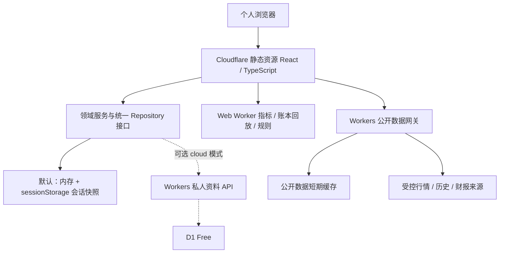

# 个人量化分析系统详细设计 v0.1

日期：2026-11-11。状态：设计评审稿；本稿没有实施、部署或在线验收的含义。

## 1. 设计基线与阅读顺序

业务依据为 [业务方案 v0.3](quant-system-business.md)，技术依据为 [技术方案](quant-system-technical.md)第 14、15 节及[接口验证记录](../validation/api-and-cloudflare-review.md)。技术方案前面的本机 FastAPI、SQLite 在线备份、常驻 SSE 服务和付费容器内容不作为本版实施依据。

用户明确要求完整云端、无需订阅套餐、关闭浏览器后不持续刷新，并表示临时存储即可。因此本版默认 `session` 模式：个人资料在浏览器会话中保存，公开资料按需由云端接口获取。技术方案第 15 节提出的 D1 免费持久化仍是可选方案，不能解释为用户已经选择持久存储。两种模式共用领域模型，启用 D1 时才增加私人资料写入 API、数据库及跨设备恢复。

| 文档 | 负责解决的问题 |
| --- | --- |
| [本稿](2026-11-11-quant-system-detailed-design.md) | 架构、边界、决策与业务验收对应 |
| [数据与台账](../design/data-and-ledger.md) | 字段、约束、导入、成本、交易、更正和并发 |
| [接口契约](../design/api-contract.md) | 请求、响应、分页、版本、错误及供应商适配 |
| [计算与研判规则](../design/calculations-and-rules.md) | 历史区位、财务、趋势、组合和五类研判 |
| [页面与实时流程](../design/pages-and-realtime.md) | 页面字段、操作流程、刷新、提醒和状态 |
| [免费云部署与验证](../design/cloud-and-validation.md) | 免费额度、鉴权、云端验证、交付与验收 |

## 2. 系统结构



“完整云端部署”表示网页和必要 API 均在云端提供，使用时无需本机 Python 服务；浏览器承担计算和会话状态属于该架构。默认不使用 Cron、Queues、持续采集、推送守护进程、Containers 或收费模型服务。

建议前端 React、TypeScript、Vite、ECharts；轻量 HTTP Worker；共享纯 TypeScript 领域包；金额运算使用经评估的十进制库，锁定版本并记录许可证。数据库 SQL 仅在选用 D1 时落地。生产版本不包含当前早期 Python 原型，也不假设 Python 技能可直接运行于 Workers。

建议源码边界（后续开发创建，本轮不创建程序）：

```text
apps/web/                 页面、状态、表单、图表、会话存储
apps/gateway/             鉴权、来源适配、限流、可选 D1 API
packages/contracts/      类型、校验、错误、数据版本
packages/domain/         台账、行业聚合、规则、指标纯函数
packages/providers/      来源映射、标准化与质量检查
fixtures/public/         可公开的脱敏契约样本
migrations/              可选 D1 迁移
```

## 3. 模块及运行边界

| 模块 | 输入 → 输出 | 运行位置 |
| --- | --- | --- |
| 证券主数据 | 来源代码 → 交易所证券身份、币种、行业及证据 | 网关取数，浏览器合并手动覆盖 |
| 自选与持仓 | 手动输入/导入 → 自选、事件流、持仓投影 | 默认浏览器；D1 模式服务端确认写入 |
| 行情网关 | 固定证券 ID、周期 → 标准报价/历史/财报 | Workers，有界分包、超时、缓存 |
| 计算引擎 | 带版本的数据包 → 指标与质量原因 | Web Worker，按证券分块 |
| 研判引擎 | 指标、风险、规则版本 → 五类标签及证据 | Web Worker；不依赖大模型 |
| 页面调度 | 活跃市场、订阅集合 → 分批轮询 | 浏览器，单轮不重叠 |
| 条件提醒 | 相邻有效样本、规则 → 触发/恢复/缺口 | 浏览器；关闭期间不监测 |
| 导出/报告 | 当前快照与来源 → JSON/CSV/Markdown | 浏览器；敏感文件由用户下载 |

原始数据、标准化数据、派生指标分层。每一层保留来源和版本；缺项用有原因的空值表示。一个供应商失败只影响相关证券或字段，不能将整批标记为零或空仓。

## 4. 存储模式的具体行为

| 行为 | 默认 session | 可选 cloud / D1 Free |
| --- | --- | --- |
| 自选、持仓、交易、备注、视图 | 当前会话 | 云端个人空间 |
| 同标签页正常刷新 | 尝试从 sessionStorage 恢复 | 重新读取服务端版本 |
| 关闭后恢复 | 不保证，需主动导出后再导入 | 重新登录后读取 |
| 跨标签页 | 显式复制会话；复制后各自独立 | 共享数据、版本冲突检测 |
| 跨设备 | 导出/导入 | 登录同步 |
| 原始行情及完整历史 | 内存缓存 | 仍以内存/公开短缓存为主 |
| 条件规则和触发历史 | 会话内 | 可保存，但关闭后仍不监测 |

首次使用及页头显示“会话模式，关闭后不保证恢复”，提供导出入口。sessionStorage 写入失败时显示“当前仅内存，刷新可能丢失”，禁止显示保存成功。退出登录或用户主动清空时清除会话私有数据。浏览器会话恢复行为不能作为数据恢复承诺。

模式通过启动配置固定，禁止悄悄把私人资料同步到云端。以后切换为 D1 时走“导出当前数据 → 导入预览 → 明确提交”，不自动合并两份持仓。

## 5. 已决定和仍待评审的项

| 项目 | 本版处理 |
| --- | --- |
| 默认部署 | Cloudflare 免费层，前端及网关云端运行 |
| 默认保存 | 沿用用户明确要求的会话临时保存 |
| 关注范围 | A 股、港股、ETF；美股首版仅主要指数 |
| 重点筛选 | 国资属性有证据；A 股价格严格 `<20 CNY`；港股价格条件独立 |
| 假想买入预览 F | 排除；保留真实交易录入的金额核对 |
| 成本口径 | 提议含买入费用加权平均，须和确认基准对账 |
| 规则阈值 | 文档给出可复现候选值，标注“试行”，未通过效果验收 |
| 5 秒刷新 | 目标值，可配置和自动退避；不承诺源端实时 |
| D1 持久化 | 免费可选，尚未启用 |
| 完整自选发往供应商 | 延续待明确授权状态；当前设计工作不再发送私人清单 |

央企、地方国企与红筹不是互斥行业，也不能由低价或名称推断。持仓不因筛选条件被隐藏；不符合研究池条件的持仓仍显示并可单独筛选。

## 6. 现有技能如何整合

A-Stockit 的技术指标、分析阶段和数据质量处理作为公式与测试样本参考；移植时标记具体文件、提交版本、许可证和适用市场。A 股档案技能映射至财务、资本行为及风险证据字段；Pandadata 仅作为可选来源，未配置凭据的字段保持不可用。Superpowers 用于设计、开发和验证流程。

它们在磁盘上仍是独立技能；产品通过统一数据契约和规则整合其可用能力。不能将安装技能等同于已连接数据、已有网页功能或已经完成分析验证。

## 7. 业务验收追踪

| 业务编号 | 详细设计落点 | 核验重点 |
| --- | --- | --- |
| 1 | 页面 §2、数据 §2 | 增删自选、恢复、分组与持仓并存 |
| 2 | 数据 §3–5 | 期初、费用、买卖、清仓、更正和重复提交 |
| 3 | 数据 §2、计算 §5 | 行业覆盖、手动覆盖、ETF 和 A/H 聚合 |
| 4 | 计算 §2–3、页面 §4 | 多周期、三年极值、缺数语义 |
| 5 | 计算 §6 | 低价与风险、趋势、资料和仓位分别说明 |
| 6 | 计算 §1、页面 §2 | 19.99 通过、20 排除、持仓不受过滤 |
| 7 | 页面 §1、§6 | 三地状态、时点和报价驱动汇总 |
| 8 | 页面 §6–7 | 关闭停止、重开刷新、监测空档 |
| 9 | 页面 §6、云端 §5 | 交易状态、断线恢复、源端延迟 |
| 10 | 页面 §2、§6 | 视图恢复边界、阅读位置、手动重排 |
| 11 | 页面 §5、§7 | 已公告/预计日期、提醒方向、冷却和回看 |
| 12 | 数据 §4、计算 §5、§7 | 收益对账、缺流水、同行比较 |
| 13 | 计算 §5 | 原币、人民币、汇率日期及覆盖率 |
| 14 | 页面 §4–5、接口 §6 | 备注、导出、报告、证据回查 |
| 15 | 计算 §2 | 52 周/两年/三年/上市以来及三个不同指标 |
| 16 | 计算 §4 | 五完整财年、缺失/零/亏损/ETF、PE 来源 |
| 17 | 页面 §1、计算 §8 | 可下钻统计和清晰分母 |
| 18 | 计算 §2、页面 §4、接口 §3 | 旧低点、跨源差异、缺分时和成交单位 |

## 8. 下一阶段入口

本稿评审后进入六个页面的交互原型，再按公共样本云端接口 → 会话台账 → 图表和规则 → 完整验收的顺序开发。免费层可行性、港股延迟和未覆盖资料须在开发前期验证，不以设计文档代替验收。原型前最重要的产品取舍是是否继续采用默认会话模式；在用户改选之前均按会话模式推进。
