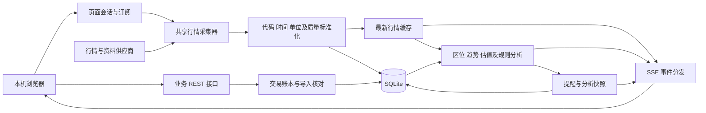

# 个人量化分析系统技术方案

版本 v0.1 · 2026-11-11 · 技术评审稿

> 后续约束更新：用户选择完整云端部署且不订阅付费套餐。免费层也支持持久存储，存储方案澄清及当前建议见第 15 节。第 14 节保留会话临时存储选项，最终数据保留范围待用户核定。前文 Python/SQLite 与 Containers 路线保留用于对照。

> 详细设计入口：[2026-11-11 详细设计 v0.1](2026-11-11-quant-system-detailed-design.md)。为遵循用户已明确的“临时存储就行”，详细设计默认采用第 14 节会话模式，第 15 节 D1 免费持久化保留为可选方案。实现时以该详细设计明确的边界为准；旧版本机部署、常驻服务和付费容器内容不作为当前实施要求。

## 1. 设计输入与当前状态

以业务方案 v0.3 为范围依据，覆盖三地大盘、A 股/港股/ETF 自选和持仓、行业分类、多周期与历史价位、五年盈利、总体研判、事件提醒、收益拆解及同区间比较。

当前项目有已安装技能、历史 Markdown 清单、导入解析器和基于标准库 HTTP 的服务初稿。初稿只保存整份归档 JSON，尚未形成正式交易账本、前端或实时采集服务。后续实施需按本方案逐步替换服务入口，复用经验证的解析逻辑并保留原始资料。

本轮产物为技术设计，原型和正式开发在评审后开展。刷新目标、费用及成本口径、研判阈值等建议参数明确标为待核定。

2026-11-11 已补充接口实测及 Cloudflare 部署评估，详见 docs/validation/api-and-cloudflare-review.md。本方案第 11 节描述本机路线；Cloudflare 混合或完整部署为待选择路线。公开报价已有超时和港股指数延迟证据，三地 5 秒目标尚未验收。

## 2. 架构路线与技术选型

| 路线 | 适用性与取舍 |
| --- | --- |
| Python 服务与 React 前端的模块化应用 | 推荐。可复用 Python 数据分析，适合持续更新的表格、图表和交易录入；需要维护前后端接口 |
| Python 与 Streamlit | 构建数据页面较快；复杂表单、稳定列表排序、多页面共享采集和细粒度状态需要额外处理 |
| 直接扩展大型开源平台 | 可获得成熟研究模块；仍需适配个人台账、跨市场数据、实时浏览器界面和具体研判规则 |

建议采用下列组件，开发前锁定版本并验证兼容性。

| 层次 | 组件 | 用途 |
| --- | --- | --- |
| 界面 | React、TypeScript、Vite | 六个业务页面、表单、筛选与状态管理，构建后随本机服务交付 |
| 图表 | Apache ECharts | 分时、K 线、均线、区间位置、年度利润、行业分布及归一化比较 |
| 接口 | Python 3.12、FastAPI、Pydantic、Uvicorn | 参数校验、业务接口、静态资源与实时事件流 |
| 数据存储 | SQLite、SQLAlchemy、Alembic | 本机台账、证券资料、历史行情、分析快照和可回滚的结构迁移 |
| 分析 | pandas、NumPy、Decimal | 时间序列指标、财报指标及金额核算 |
| 行情与资料 | 独立供应商适配器、AKShare 候选接入 | 获取不同市场和不同周期数据，统一字段、时间和质量状态 |
| 实时分发 | SSE 事件流，REST 处理写入与订阅管理 | 后端向页面推送报价、估值、分析进度及提醒 |

FastAPI 的 lifespan 用于初始化和释放服务资源。采集器作为受控的共享任务运行，订阅决定其运行状态。SSE 支持服务端事件及断线重连，首次连接和重连都能获取完整快照。[生命周期文档](https://fastapi.tiangolo.com/advanced/events/) · [SSE 文档](https://fastapi.tiangolo.com/tutorial/server-sent-events/)

SQLite 使用 WAL，允许读写并行但写事务仍需串行协调。数据文件位于本机磁盘，设置外键、忙等待及短事务，台账写入采用单一业务入口。[WAL 文档](https://www.sqlite.org/wal.html)

## 3. 系统组成与数据流

同一证券的持仓、自选和个股详情共享一次行情获取。多个浏览器标签页共享采集器与缓存，订阅取并集。各模块以证券 ID、数据版本和分析时点关联。

## 4. 数据源与实时能力验证

### 4.1 数据接入安排

| 数据 | 候选来源 | 接入前验证 |
| --- | --- | --- |
| A 股、港股、ETF 报价及指数 | AKShare 对应公开行情接口；适配器预留授权行情供应商 | 标的覆盖、源端时间、实际延迟、单位、限频和故障恢复 |
| 美股三大指数 | AKShare 指数接口目录中适用接口；必要时选择具备相应指数授权的供应商 | 区分指数与 ETF、常规/盘前盘后可用性、时区及延迟 |
| 日线与分时 | AKShare 对应证券接口和经核实的补充源 | 前后复权、原价、分钟覆盖、最长历史起点、停牌和缺口 |
| 五年财报、分红和公告 | AKShare 对应资料接口，交易所/公司披露用于核验 | 归母利润、完整财年、披露日期、币种、单位、修订版本 |
| 行业和国资属性 | 资料接口及公司披露证据，用户可手工核对 | 分类体系映射、实际控制权证据及生效日期 |
| 汇率 | 具有可核实日期和报价方向的汇率接口 | HKD/CNY 方向、日内或日度频率、休市沿用日期 |
| Pandadata 档案 | 配置账号后的可选适配器 | SDK、账号权限、接口返回字段和服务地址 |

AKShare 官方列有股票、指数及财务等接口。指数文档提供沪深指数报价接口，股票总貌部分接口说明当日数据收盘后统计。按字段的实际频率接入，保留获取时间与源数据时点。[股票接口目录](https://akshare.akfamily.xyz/data/stock/stock.html) · [股票行情文档](https://akshare.akfamily.xyz/data/stock/stock_quote.html) · [指数文档](https://akshare.akfamily.xyz/data/index/index.html)

公共接口作为候选，接口存在不能证明全量 已脱敏数量、全部市场或全部时段能达到 5 秒更新。正式接入先以 A 股、港股、ETF 及三地指数逐类取样，再验证全量覆盖和连续运行。若需要付费行情，记录可解决的缺口、延迟、授权和费用，交用户选择后接入。

### 4.2 供应商统一契约

每次返回统一包含 instrument_id、source、source_symbol、currency、unit、market_session、source_time、received_at、delay_type、quality_flags。源端缺时间戳时保留空值并标记时效未知，接收时间单独记录。

能力表逐项保存 quote、intraday、daily、adjustment、financials、events、history_start、timestamp_available、batch_limit、rate_limit 和供应商声明的延迟。对不支持项返回明确状态。

最新有效数据和最近一次抓取尝试分开保存。失败记录不会覆盖有效价格，过期价格仍附原时间。回退供应商时推送来源变化，经过单位、复权和时间校验后再用于分析。

### 4.3 接入验证矩阵

| 验证组 | 样本和规模 | 需要记录的证据 |
| --- | --- | --- |
| 实时报价 | A 股、港股及 ETF 分别取正常成交、停牌或无成交样本，再覆盖全部自选和持仓 | 源端时间、延迟类型、请求耗时分位数、连续失败、实际全量完成间隔 |
| 指数 | 业务方案中九个默认指数逐个验证 | 指数身份、当前点位、交易日、币种/点数、更新时间和市场状态 |
| 历史 | 长期上市、上市不足三年、发生分红拆合股的证券 | 日线起点、缺口、有效日数量、原价与复权对照、历史极值日期 |
| 分时 | 不同市场各取一个实际交易日 | 分钟粒度、午休/跨日、成交量单位和缺失区段 |
| 财报 | A 股、港股各取五年盈利、存在亏损、上市不足五年及资料缺失样本 | 财年、归母字段、币种倍率、利润与收入、披露及修订日期 |
| 事件与行业 | 现有持仓及有近期事件的自选 | 公告链接、预计/确定状态、行业映射和人工核对记录 |

上述矩阵为后续接入阶段的实测任务，本次仅核查文档和现有初稿。原业务要求保留到验收，未获得的能力持续列为未完成。

## 5. 页面订阅与刷新机制

### 5.1 打开、关闭与重连

1. 页面创建会话，提交当前需要的证券、指数和分析视图，先接收缓存快照及质量状态。
2. 后端建立 SSE 事件流，按照活跃市场和能力表安排共享采集。标签页切换更新订阅，所有自选仍按选定频率跟踪，个股详情额外订阅分时。
3. 页面心跳与 SSE 连接共同维护会话。关闭时尽力注销，异常退出由会话租约超时回收。建议 15 秒心跳、45 秒租约，并在实现阶段验证后台标签页限流行为。
4. 最后一个有效会话结束后取消定时采集、提醒和自动补数任务，结束已有请求后落盘。关闭行为检测有租约宽限时间，界面和设置明确这一点。
5. 重新打开先校验交易状态、补取最新报价，再补历史与事件资料。断线重连使用事件序号，事件已被清理时发送完整快照。

### 5.2 调度与性能

报价以 5 秒作为待验证的全量目标。按供应商批量能力分包，以持仓、当前详情及指数优先，避免给每个列表行建立计时器。每个源有限速队列、请求超时、重试退避及并发上限。手动刷新加入同一限速队列。

同步供应商调用放入有界线程池，避免阻塞 API 事件循环。历史与财报补齐分批执行，实时请求预留并发容量。长期重计算可放入受控计算进程，结果提交仍通过统一写入口。

5 秒内未完成上一轮时合并待执行请求，避免重叠积压。全量扫描耗时和每个证券报价年龄分别可见，降频和缺覆盖在数据状态页展示。

| 数据任务 | 建议触发 |
| --- | --- |
| 报价、估值与价格筛选 | 有效新报价到达后，目标周期 5 秒 |
| 详情分时与分钟指标 | 源端支持的新分钟数据到达时 |
| 历史极值、均线基线及五年财报 | 初次导入及资料变化后，页面活跃时增量补齐 |
| 事件、汇率、行业及控制权 | 按来源频率及资料新鲜度更新，展示各自时点 |
| 收盘复盘 | 页面活跃且确认当日数据可用时生成，错过时在下次打开后补生成并标注生成时间 |

指数成份全市场广度使用独立低频任务，记录统计范围，个人自选涨跌由自选报价计算。盘中报价缓存驻内存，按需保存分钟数据、分析变化和提醒，避免将全部轮询结果无限写入数据库。

时间以带时区时间戳保存，内部统一 UTC，展示采用市场时区及 Asia/Shanghai。交易日历按交易所维护，识别午休、半日市、临时停市及美国夏令时。

## 6. 数据模型与存储

| 领域 | 主要实体与关键约束 |
| --- | --- |
| 证券资料 | instruments、source_symbols、issuers、industries、industry_assignments、ownership_evidence。主键为交易所与代码，品种单独记录，A/H 关联同发行人 |
| 自选 | watchlists、watchlist_members、saved_views、research_notes。分组成员唯一，可追溯新增与移除 |
| 台账 | accounts、opening_snapshots、ledger_events、ledger_revisions、cash_flows、corporate_actions、position_projections |
| 行情 | latest_quotes、daily_bars、intraday_bars、adjustment_factors、fx_rates、market_calendars。包含来源、时间、单位及复权版本 |
| 财务与事件 | fiscal_reports、financial_facts、events、source_documents。按财年、披露日期及版本保留 |
| 分析 | analysis_snapshots、rule_versions、alerts、alert_occurrences、reports |
| 运维 | import_batches、fetch_runs、data_quality_issues、schema_versions |

金额、成交价、数量和汇率使用 Decimal 计算，持久化为规范十进制文本。图表绘制可转浮点，账本运算保留精度，舍入规则按币种及费用口径配置，记录来源原值。证券代码使用字符串保留前导零。

日线按证券、交易日、来源、复权方式和修订版本唯一。分析窗口按日历区间或有效交易日显式指定。财务记录保存财年结束日、披露日、归母口径、币种和倍率。

迁移脚本编号管理，导入和迁移前备份。备份采用 SQLite 在线备份 API，恢复时校验完整性与结构版本。[SQLite 备份文档](https://www.sqlite.org/backup.html)

## 7. 持仓账本和收益核算

### 7.1 写入流程

录入表单 → 服务端校验 → 返回数量/金额/费用核对结果 → 用户提交 → 在一个事务内写入事件与投影版本 → 更新持仓、收益和行业汇总。

每次提交携带幂等键，重复提交返回原结果。编辑记录携带版本号，检测多页面冲突。更正和删除误录记录撤销/替代关系，保留原记录。补录历史事件按发生时间及稳定顺序重放，出现中间负持仓时退回核对。

导入保存原文件摘要、行号和原始字段，建立预览批次，确认后一次提交。同一批次幂等。历史清单中的报价和持仓属于归档，确认后的持仓快照才作为账本起点。

### 7.2 金额与成本

以加权平均为建议实现，业务口径确认后启用。设原数量 Q、账面成本 C，买入数量 q、成交价 p、买入费用 f，新增账面成本为 C + q×p + f，平均成本为新增成本÷新增数量。

卖出按卖前平均成本释放账面成本，已实现盈亏为净卖出收入减释放成本。卖出费用计入净收入，避免收益拆解中再次扣减。清仓后数量和剩余成本归零，尾差按已确认规则处理。

分红记录税前金额、税费和净额。转入转出保留转移成本，内部账户转移在合并组合层抵消。送股、拆合股按已核对事件更新数量与单位成本，并保留总成本处理依据。

本币盈亏先计算，再按有日期的汇率展示人民币估值。只有存在足够交易与兑换资料时才拆分汇率贡献，方法版本、基准汇率及覆盖范围可查。真实组合日盈亏结合现金流计算，单纯按价格变化估算的值明确命名。

## 8. 历史区位、财务和比较

- 原价用于报价、成交及估值。分析序列采用同一基准日的前复权因子，因子修订后失效并重算受影响的极值、均线和分位缓存。
- 三年、两年及 52 周使用滚动日历窗口，20/60 日使用有效交易日窗口。当前报价对齐同一复权基准，盘中高低点合入当日临时 K 线，已完成 K 线与临时 K 线分别保存。
- 日线聚合周/月/年 K 线，注明周期是否完成。分时曲线由真实盘中采样或供应商分钟数据形成，注明粒度及缺口。
- 上市以来极值需核实上市日和完整历史覆盖，未满足时标为可用历史极值。距离低点、区间位置和价格分位分别计算，零或无效分母返回带原因的空值。
- 五年财报选取截至分析时点已披露的最近五个完整财年，按来源保留修订记录。年度利润大于零才记盈利，零、负数、缺失分别统计，ETF 标为不适用。
- 净利率使用同财年归母利润与营业收入，单位和币种匹配。PE(TTM) 保存来源、值和时点，缺失原因未知时保持未知。
- 价格比较按共同有效起点归一化，跨市场休市日保留缺口或明确前值展示标记。同行估值使用一致指标和报告期，并标出同业样本范围。历史对比使用当时已披露资料，避免未来数据进入当时判断。

## 9. 研判规则和技能复用

规则分析输入由 quote_version、history_version、financial_version、ownership_version、portfolio_version 和 rule_version 组成，同一次结论明确引用输入版本。

各维度输出指标值、触发规则、依据、缺项及状态，再形成业务方案的五类结论。关键资料不足时返回资料不足，重大风险单列原因。标的研究结论与个人仓位约束分别输出，默认评分阈值须在规则表评审。

报价变化只重算价格区位、估值和相关规则，财报与行业缓存按版本失效。避免每 5 秒对 已脱敏数量重新计算全部历史或调用模型。

| 现有技能 | 整合方式 |
| --- | --- |
| A-Stockit | 通过 Python 适配层调用纯分析函数，固定输入与版本。核实 A 股代码、日期、前复权和指标口径后复用；港股与 ETF 只启用验证适用的指标 |
| A 股档案技能 | 将其研究字段和证据要求映射到个股档案，Pandadata 账号配置后调用相应数据适配器 |
| Superpowers | 用于方案、原型、开发、调试和验证流程，作为项目开发工作流 |

现有技能文件存在于源目录和项目发现目录，实施时记录来源清单并选定唯一运行时来源，自动核验副本一致性。外部技能代码保留许可证及版本。模型生成解读若后续接入，单独配置服务与凭据，引用已计算事实并缓存结果。数值计算和基础研判可由规则引擎独立运行。

## 10. API 与前端状态

| 接口组 | 主要操作 |
| --- | --- |
| /api/instruments、/api/watchlists | 搜索、证券资料、自选增删及分组、保存视图 |
| /api/accounts、/api/ledger、/api/imports | 期初、交易核对及提交、更正、导入预览及确认、历史投影 |
| /api/markets、/api/quotes、/api/history | 大盘、最新报价、分时和多周期历史及数据覆盖 |
| /api/analysis、/api/financials、/api/compare | 研判、区位、五年盈利、同行和指数比较 |
| /api/events、/api/alerts、/api/reports | 日历、提醒规则与触发记录、复盘 |
| /api/sessions、/api/stream、/api/data-status | 页面租约、订阅变更、实时事件与任务状态 |

写接口使用结构化参数和版本校验，金额返回十进制字符串。错误包括参数不合法、资料缺失、数据过期、版本冲突和供应商限频，前端展示可执行处理方式。

实时消息带 event_id、snapshot_version、instrument_id 和 observed_at。完整行情包先统一更新缓存，再推送对应版本的组合汇总，避免前端在不同报价版本之间闪动。慢页面合并最新行情消息，提醒等业务事件持久化后可重取。

列表将证券身份、选中行、滚动位置、筛选条件和排序独立保存。增量更新单元格，用户主动重排。图表按周期和证券复用实例，切换或卸载时释放资源。[ECharts 图表容器文档](https://echarts.apache.org/handbook/en/concepts/chart-size/)

## 11. 本机部署与数据保护

建议单个 Python 服务进程绑定 127.0.0.1，同源提供前端构建文件、REST 和 SSE。安装于本项目，独立 Python 虚拟环境和前端锁文件管理依赖。开发阶段使用 Vite 开发服务，正式本机使用构建产物。

部署提供启动、停止和备份 PowerShell 脚本，启动前检查依赖、端口、数据库版本及已有进程，重复启动返回现有入口。运行服务可保持待机，全部页面关闭后采集与条件监测停止。

private/ 保存数据库、导入原件、备份和必要缓存，排除出版本控制。供应商凭据放入本机私有配置，日志隐藏凭据和账户敏感字段。写接口校验来源、会话令牌和 Content-Type，提供受控静态文件和导出路径。

备份建议保留最近 7 份及最近 4 份周备份，数量可配置。真实恢复演练验证持仓数量、交易版本和自选一致性。

## 12. 验证与交付顺序

| 阶段 | 交付 | 验证依据 |
| --- | --- | --- |
| 技术评审 | 本文、数据源验证矩阵及规则待定清单 | 逐项对应业务方案 v0.3 |
| 原型 | 总览、自选、持仓、个股、事件提醒、资料设置的交互原型 | 用实际字段走通查看和录入流程，样例与真实数据标识清楚 |
| 数据与账本 | 来源适配、导入预览、SQLite、交易及版本记录 | 重复导入、补录、清仓、更正、费用和跨币种对账 |
| 实时与分析 | 订阅、三地报价、历史区位、五年盈利和规则研判 | 全量覆盖、源端时间、租约关闭、多标签页、断线恢复和指标对账 |
| 完整业务 | 行业、收益拆解、事件、批量提醒、视图和比较 | 业务方案全部 18 项验收逐项有记录 |
| 部署 | 本机入口、日志、备份恢复和操作说明 | 启动、停止、重启、打开与关闭页面及实际恢复演练 |

自动验证重点覆盖金额运算、回放幂等、财报缺失语义、复权一致性、时间边界和订阅回收。外部接口保存脱敏样例做字段契约校验，另以真实行情进行在线验收。浏览器验证覆盖筛选、录入、图表、提醒、重新打开和列表稳定性。

建议本机缓存页面首屏 2 秒内可用，报价到达后计算与界面更新 p95 小于 1 秒，实际供应商取数耗时和源端延迟单独报告。这些是验证目标，开发与行情接入后据实记录。

## 13. 评审重点

推荐采用 Python/FastAPI + React/TypeScript + ECharts + SQLite 的本机架构。该路线是本次技术建议，尚待用户评审。

优先验证三地指数与自选实时报价、五年港股财报、最长历史及复权完整性。公开源无法满足的条目保留为实时或数据覆盖待完成，并提交可选来源与成本，不将其改判为已验收。

成本及研判规则先依据业务口径形成可审阅规则表，再用于实现。付费行情和模型服务的凭据与费用在选择具体服务时确认。

## 14. 完整云端免费层与临时数据路线

用户明确不需要永久存储，当前设计改为 React/TypeScript 前端托管在 Cloudflare，Workers Free 提供无状态行情与资料接口。趋势、财务规则和个人台账计算迁移为 TypeScript，主要在浏览器执行，按需分批计算。现有 Python 技能的公式和分析流程作为移植依据，数值结果需对照验证。

### 14.1 数据存放

| 数据 | 当前方案 |
| --- | --- |
| 自选、持仓、成交、费用、分红、行业手动调整及研究备注 | 浏览器会话数据，正常刷新通过 sessionStorage 恢复同一标签页状态。关闭标签页后不保证恢复 |
| 当前报价和图表 | 浏览器内存缓存。Worker 对公开行情可使用短期缓存，缓存未命中时重新获取 |
| 历史日线、五年财报和行业资料 | 页面打开后按需分批取回，会话内复用，标注来源与覆盖 |
| 提醒和研判变化 | 当前会话内记录，关闭期间形成监测空档 |
| 用户私有数据 | 导入在浏览器解析，按业务需要发送证券代码取数。公开前端静态资源中不嵌入个人持仓原件 |

Worker 的进程内存仅作可丢弃优化，跨请求、跨节点及重启均不依赖其保存个人台账。基础运行不依赖 D1、R2 或 Containers。正常刷新恢复是会话便利功能，浏览器清理和恢复行为可能影响会话数据，不提供跨设备同步或恢复承诺。

首次进入可导入用户选择的历史清单，或手动新增。当前临时存储要求意味着人工新增和更正可能在关闭后丢失；为便于用户保留当次工作，可使用业务方案已经包含的导出，之后自行选择文件重新导入。导出由用户主动操作。

### 14.2 刷新和免费层约束

页面每轮批量请求当前所需公开报价，多个页面的同一公开行情可利用短期缓存。浏览器关闭后自然停止轮询，重新打开先重新取数。历史与财报按会话需求取回，指标基线在浏览器保留，实时更新只重算有关指标。

Cloudflare 免费层的请求、CPU 和存储额度均有上限，纯 Workers 服务只处理输入校验、受控供应商取数、字段标准化和短期缓存。重计算放在浏览器中分块执行，必要时采用 Web Worker，避免阻塞交互。服务端固定允许的供应商与参数，避免开放任意 URL 转发。

Workers Free 当前每日请求限额为 100,000，CPU 每次调用限制见官方平台文档。D1 和 SQLite-backed Durable Objects 也有免费配额，但本路线不依赖其持久化能力。配额耗尽时停止相关调用并展示状态，保持免费套餐运行。[Workers 限制](https://developers.cloudflare.com/workers/platform/limits/) · [D1 计费](https://developers.cloudflare.com/d1/platform/pricing/) · [Durable Objects 计费](https://developers.cloudflare.com/durable-objects/platform/pricing/)

5 秒批量刷新一天连续 24 小时约 17,280 轮，这只是单请求每轮的估算，不包含分包、资料、重试和其他接口，必须据实际调用次数与 CPU 用量核算。初次加载全部历史的网络耗时需要在原型后验证。

### 14.3 仍需验证

此路线的完整功能依赖 TypeScript 数据适配和浏览器计算移植，以及 Cloudflare 出口实际获取行情的成功率。现有本机 AKShare 成功结果只能说明数据源候选可取数。恒生及恒科样例仍存在约 15 分钟延迟，免费云部署不会改变源端延迟。三地 5 秒实时目标继续保留为待验证项。

个人台账的关闭后保留范围需要向用户明确确认；当前按全会话临时数据设计，尚未执行云部署。

## 15. 免费持久存储澄清与推荐组合

免费层运行与数据持久化可以同时满足。此前将无订阅部署直接引向全会话临时存储的说明不充分，持仓和成交无需因为免费部署而在关闭页面后丢失。

建议 React 前端 + TypeScript Workers Free API + D1 Free 保存自选、交易、分红、行业修订、备注、视图和提醒规则。公开行情及计算结果按时效临时缓存，关闭最后一个页面后停止持续刷新，个人资料可供下次打开恢复。浏览器计算承担较重指标任务，Worker 保持有界取数和结构化查询。数据保留方式仍由用户选择，本节为结合免费额度提出的推荐。

D1 当前免费配额每日读取 500 万行、写入 10 万行，总存储 5 GB；单个免费数据库上限 500 MB。行扫描和索引写入都影响配额，使用索引、分批初始导入和增量更新，并在界面显示配额状态。报价按需缓存，避免每 5 秒把全部行情写入数据库。[D1 定价](https://developers.cloudflare.com/d1/platform/pricing/) · [D1 限制](https://developers.cloudflare.com/d1/platform/limits/)

KV 有免费额度，适合低频配置或允许短时旧值的缓存，账本写入与一致性由 D1 处理。R2 有免费用量，其启用及超额按量计费需单独核对，本推荐的基础运行不依赖 R2。Containers 要求 Workers Paid，完整 Python 容器路线不符合当前无订阅约束。[KV 定价](https://developers.cloudflare.com/kv/platform/pricing/) · [R2 定价](https://developers.cloudflare.com/r2/pricing/) · [Containers](https://developers.cloudflare.com/containers/)

免费持久化适用于个人资料量的预期判断，实际历史行情、读取次数、写入及 CPU 用量仍需压测。免费层的云存储能力不会消除外部行情延迟，Cloudflare 出口和免费行情的活跃时段验证继续作为待完成项。
